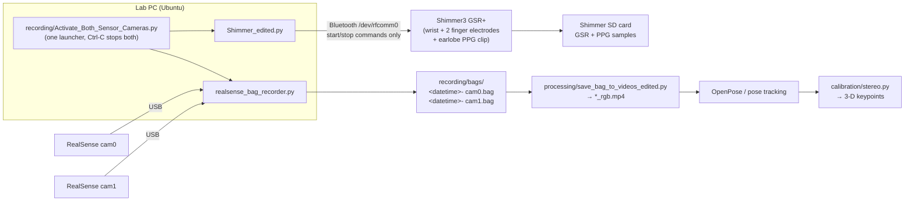

# HRI Sensing Toolkit: Stereo RealSense + Shimmer GSR/PPG

Scripts for recording **synchronized-by-timestamp video from two Intel RealSense cameras** and **skin conductance + pulse (GSR/PPG) from a Shimmer3 GSR+**. Also includes offline video conversion and a **stereo calibration** of the two cameras for 3-D reconstruction.

These were built for a human–robot interaction user study with a Sawyer arm, where participants' posture and physiological arousal were recorded while they guided the robot. Nothing here depends on the robot, though. It works for any lab session where you want **two-camera video + wearable physiology** from one command.

> Companion repo: **[sawyer-hri-study](https://github.com/AmrHamdi97/sawyer-hri-study)** has the robot control, the game and the trial conditions.

---

## What it records



| Stream | Device | Format | Where it ends up |
|---|---|---|---|
| Colour video ×2 | Intel RealSense (D400-series) | 1280×720 BGR @ 30 fps, depth disabled | `recording/bags/*.bag` on the PC |
| GSR (skin conductance) | Shimmer3 GSR+ | Shimmer SD log | **On the Shimmer's SD card**. Copy it off with Shimmer ConsensysPRO |
| PPG (pulse, convert to heart rate) | Shimmer3 GSR+ earlobe clip (internal ADC A13) | Shimmer SD log | same |

---

## Repository layout

```
recording/
  Activate_Both_Sensor_Cameras.py   launcher: starts both recorders, forwards Ctrl-C
  realsense_bag_recorder.py         records every connected RealSense to recording/bags/
  Shimmer_edited.py                 Shimmer GSR+/PPG: start SD logging, stop on Ctrl-C  (the one used)
  Shimmer.py                        earlier version (labelled "EMG", same sensor bytes)
  shimmer_stream.py                 pyshimmer test: stream live packets for 5 s
  bags/                             output folder (bags are git-ignored)
processing/
  save_bag_to_videos_edited.py      recursively converts every .bag under a folder to *_rgb.mp4
  save_bag_to_videos.py             earlier version with a folder picker dialog
  save_bag_to_videos_fixed_640x480.py  variant that forces 640×480
calibration/
  stereo.py                         load calibration, check validity, triangulate 3-D points
  session1_2025-02-01/              first stereo calibration (+ calib_log.txt)
  session2_updated/                 second calibration (+ calib_log.txt)   ← most recent
  session2_shared_copy_labels_swapped/  copy of session 2 shared with a collaborator, camera0/1 swapped
```

---

## How each part works

### 1. Launcher: `recording/Activate_Both_Sensor_Cameras.py`
- Starts `realsense_bag_recorder.py` and `Shimmer_edited.py` as two `python3` subprocesses.
- Polls every 0.5 s. When you press **Ctrl-C** it sends `SIGINT` to both, so each can shut down cleanly (close the bags, tell the Shimmer to stop logging), then waits for both to exit.
- The script paths are hard-coded to `/home/airlab5/Desktop/...`. Edit the `scripts` dict to point at `recording/` on your machine.

### 2. Cameras: `recording/realsense_bag_recorder.py`
1. Enumerates every connected RealSense (`rs.context().query_devices()`).
2. Opens a pipeline per camera, **colour only**, at 1280×720 @ 30 fps. The depth lines are commented out and can be re-enabled.
3. Waits **5 s** for auto-exposure to settle.
4. Attaches an `rs.recorder` to each device, writing `recording/bags/<YYYY-MM-DD HH:MM:SS.ffffff>- cam<i>.bag`. The bag stores every frame with its hardware timestamp, plus the camera's factory intrinsics.
5. Shows a live preview window per camera.
6. Stops on **ESC** in a preview window or on **SIGINT**.

### 3. Shimmer GSR+: `recording/Shimmer_edited.py`
The script talks to the Shimmer's LogAndStream firmware over a Bluetooth serial port (`/dev/rfcomm0`, 115200 baud). Every command waits for the `0xFF` ACK byte.

| Bytes sent | Meaning |
|---|---|
| `08 04 01 00` | **Set enabled sensors**: GSR (`0x04` in byte 0) + internal ADC A13 (`0x01` in byte 1), which is the **PPG** input on the GSR+ |
| `5E 01` | configuration command sent by the original code |
| `03` | (`Shimmer.py` only) get sampling rate. The reply is printed as `32768 / value` Hz |
| `92` | **Start logging to SD card** (logging only, no Bluetooth streaming) |
| `93` | **Stop logging** (sent on Ctrl-C) |

The data is **not** sent to the PC. It is written to the Shimmer's SD card with the Shimmer's own clock. After the session, dock the Shimmer and export the session with **ConsensysPRO** to get calibrated GSR (µS / kΩ) and PPG (mV). Heart rate is then derived from the PPG, for example by peak detection.

To pair the Shimmer once:
```bash
bluetoothctl            # pair + trust the Shimmer (PIN 1234)
sudo rfcomm bind /dev/rfcomm0 <SHIMMER_MAC> 1
```

`shimmer_stream.py` is a quick connectivity test using the `pyshimmer` library. It streams live packets on `/dev/rfcomm1` for 5 s and prints each channel. It's useful as a starting point if you want **live** data on the PC instead of SD logging.

### 4. Bag → video: `processing/save_bag_to_videos_edited.py`
- Recursively finds every `.bag` under `BASE_DIR` (edit at the top of the file).
- For each bag, it opens the file with `enable_device_from_file(..., repeat_playback=False)` and reads the colour stream's resolution. It then writes `<bag name>_rgb.mp4` next to the bag at 30 fps.
- Bags without a colour stream are skipped.

### 5. Stereo calibration: `calibration/`
The two cameras were calibrated with [python_stereo_camera_calibrate](https://github.com/TemugeB/python_stereo_camera_calibrate) (`calib.py` + checkerboard). Each session folder contains:

| File | Content |
|---|---|
| `camera0_intrinsics.dat`, `camera1_intrinsics.dat` | 3×3 camera matrix **K** and 5 distortion coefficients `k1 k2 p1 p2 k3` |
| `camera0_rot_trans.dat` | **R = I, T = 0**. Camera 0 is the world origin |
| `camera1_rot_trans.dat` | **R, T** of camera 1 relative to camera 0. T is in checkerboard units, normally mm |
| `calib_log.txt` | console output of the calibration run (per-camera and stereo RMSE) |

Per the lab notes, **Camera 0 = left camera when looking at the screen, Camera 1 = right camera.**

| Session | Angle between cameras | Baseline | Stereo RMSE |
|---|---|---|---|
| `session1_2025-02-01` | 30.7° | 124.9 units | 0.25 px |
| `session2_updated` | 22.8° | 119.2 units | 0.26 px |

The **3-D reconstruction helper** (`calibration/stereo.py`):
```python
from stereo import load_session, triangulate, distortion_valid
cams = load_session("session2_updated")
ok = distortion_valid(cams[0], uv0) & distortion_valid(cams[1], uv1)
X = triangulate(cams, uv0[ok], uv1[ok])     # (N, 3) in camera0 frame, mm
```
`python3 calibration/stereo.py session2_updated` prints the camera geometry and how much of each image the calibration covers.

---

## What it can be used for

- **Posture and proximity analysis**: run OpenPose (or MediaPipe / RTMPose) on both videos, then triangulate the keypoints. This gives a participant's 3-D posture, lean, and distance to the robot or a workstation.
- **Arousal and stress tracking**: GSR phasic peaks (skin conductance responses) and heart rate / HRV from PPG, aligned to events such as a robot error, task start, or questionnaire.
- **Event-locked analysis**: compare physiology and posture in windows before and after a known event, e.g. ±5 s around a robot's mistake.
- **Any multi-view lab recording**: rehab exercises, ergonomics studies, collaborative assembly, usability sessions. Swap in more cameras (the recorder handles any number) or turn depth back on.

---

## Setup

```bash
pip install -r requirements.txt     # pyrealsense2, opencv-python, numpy, pyserial (+ pyshimmer)
# librealsense udev rules must be installed for non-root USB access
```
Run a session:
```bash
cd recording
python3 Activate_Both_Sensor_Cameras.py     # (after fixing the paths inside)
# ... session ...  Ctrl-C to stop both
python3 ../processing/save_bag_to_videos_edited.py   # set BASE_DIR first
```

---

## Things to know before analysing data

1. **The distortion coefficients are only valid near the image centre.** Both sessions have very large k2/k3 terms (e.g. k3 = −140, +172), the sign of an over-fit. Inverting the model only works within roughly **250–340 px of the centre**, about **22–39 % of a 1280×720 frame**.
   - Points outside that region are undistorted wrongly and triangulate to nonsense. Use `distortion_valid()` to filter them.
   - **Fix options**:
     - Recalibrate with the checkerboard covering the frame corners and `CALIB_FIX_K3` (or only k1, k2).
     - Or use the RealSense **factory intrinsics stored inside each .bag** (`profile.as_video_stream_profile().get_intrinsics()`) and re-estimate only R, T with `cv2.stereoCalibrate(..., flags=cv2.CALIB_FIX_INTRINSIC)`.
2. **Camera numbering isn't fixed to a physical camera.** `cam0`/`cam1` in the bag names follow USB enumeration order, which can change between sessions.
   - The two calibrations disagree on which side camera 1 is on (T_x = −119 vs. +115), and the shared copy has camera0/camera1 swapped relative to `session2_updated`.
   - **Check each bag's serial number** (`rs.playback` → `get_info(rs.camera_info.serial_number)`) and map serial → left/right before pairing videos with a calibration.
   - For future recordings, put the serial number in the filename.
3. **There is no hardware sync.** Cameras (bag timestamps), Shimmer (its own SD clock) and any other logs (e.g. ROS) are aligned only by wall-clock time.
   - Make sure the Shimmer's clock was set from the PC (ConsensysPRO does this when configuring).
   - A visible and physiological sync event at the start of each trial makes alignment much more reliable, e.g. a hand clap in view of both cameras while wearing the sensor.
4. **The video converter writes MJPG into `.mp4` files.** Some players won't open them; use `mp4v` or `avc1`, or name the files `.avi`.
   - Bag playback runs in real time by default, so frames can be dropped if writing is slow. `playback.set_real_time(False)` avoids this.
   - Each file finishes with an "Error processing …" message. That is just the end-of-file timeout and is harmless.
5. **`Shimmer_edited.py` keeps re-sending `0x92`.** It sends "start logging" in a loop until Ctrl-C, not just once. The firmware tolerates it, but a single send is enough.
6. **`recording/bags/` must exist** before recording. It's included here as an empty folder.
